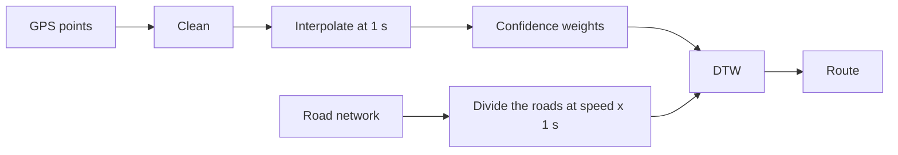

# How it works

GPS-DTW has five steps. All steps run in Rust.

| Page | Contents |
|---|---|
| [What DTW is](dtw.md) | classic DTW, and how GPS-DTW changes it for a road graph |
| [The steps](steps.md) | each step from the GPS points to the route |
| [One second on both sides](time-division.md) | why the roads are divided by time, and what goes wrong without it |
| [The cost](cost.md) | segment mode and node mode, the moves, the bearing term |
| [The confidence weight](confidence.md) | the formula and its effect |
